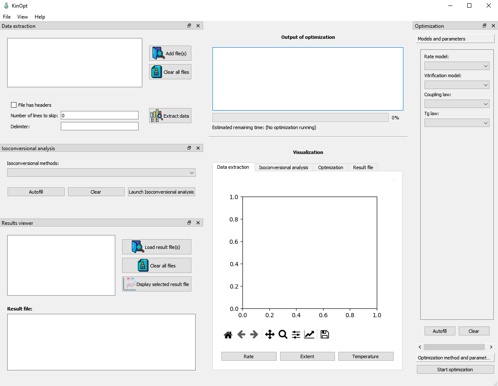

Launching the graphical interface
=================================

After :doc:`installation`, use the launcher for your operating system.

Linux
-----

Open a terminal in your graphical desktop session and run:

.. code:: bash

    kinopt

To choose where optimization results will be saved:

.. code-block:: bash

    kinopt --results-dir "$HOME/mes-resultats-kinopt"

Windows (PowerShell)
--------------------

From the extracted project folder:

.. code-block:: powershell

    .\.venv\Scripts\kinopt.exe

From any folder, use the full path (replace the location if necessary):

.. code-block:: powershell

    & "$env:USERPROFILE\KinOpt\.venv\Scripts\kinopt.exe"

To select a result folder:

.. code-block:: powershell

    .\.venv\Scripts\kinopt.exe --results-dir "$env:USERPROFILE\KinOpt Results"

See :doc:`installation_windows` for a desktop shortcut and troubleshooting.
Using the executable directly does not require activating PowerShell scripts.

Results and other launch methods
--------------------------------

By default, results go to ``KinOpt/results`` inside your desktop's Documents
folder. Relative paths supplied to ``--results-dir`` are resolved from the
terminal's current directory. The output panel shows the saved file's full path.

``kinopt --help`` and ``kinopt --version`` work without a graphical display.
With the Python environment activated, ``python -m kinopt`` is an equivalent
launcher. The historical ``python main.py`` command from ``kinopt/src`` is
also supported. Opening the interface does not start a calculation.

The GUI should look like this:

This GUI is divided in 5 parts:

1. The data extraction dock
2. The isoconversional analysis dock
3. The results viewer dock
4. The optimization dock (with the model section and optimization section)
5. The central part that display the output of docks
